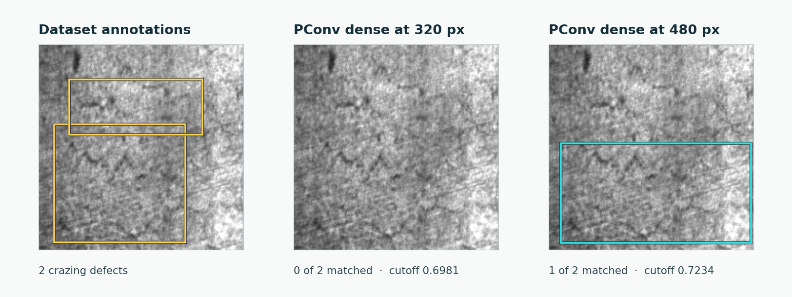
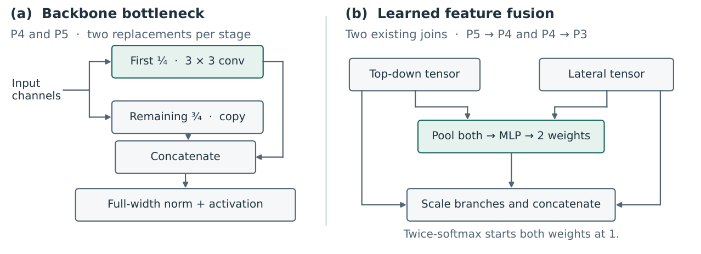

# CPU Speed and Defect Recall in YOLO Steel Surface Inspection

**Lee Ting Sen and Khalifa Alshamsi** · MLR 512, Advanced Computer Vision · American University of Sharjah

How many steel defects can a detector find on a CPU when every model gets the same allowance for false alarms? We compared four YOLO families on six hot-rolled steel defects and tested how input size, detection head, partial convolution (PConv) and learned feature fusion change the answer.

With the same PConv YOLO26n weights and dense head, increasing the input from **320 to 480 pixels** raised average recall across defect classes from **37.93% to 47.56%** on the test set. The 95th-percentile processing time roughly doubled, from **7.45 to 15.24 ms per image** on four CPU cores.

*One held-out NEU-DET image, `crazing_201`. Gold boxes mark the annotations. The cyan box is the accepted prediction from checkpoint B0. Each input size uses its own validation-fitted confidence cutoff.*

[Benchmark results](#benchmark-results) · [Experimental setup](#experimental-setup) · [Run this example](#run-this-example) · [Code and checkpoints](#code-and-checkpoints)

## Benchmark results

**Macro recall** gives each of the six defect classes equal weight at the chosen cutoff. We match detections to same-class annotations at an intersection over union of at least 0.50. **mAP50–95** averages the area under each class’s precision–recall curve at ten overlap thresholds from 0.50 to 0.95. **Pipeline p95** measures the 95th-percentile time from a decoded image to final boxes, including filtering and any non-maximum suppression (NMS). The tables give three-seed means.

### What does a larger input buy?

| PConv dense input | Test mAP50–95 | Test macro recall | False boxes per defective test image | Test pipeline p95 |
| --- | ---: | ---: | ---: | ---: |
| 320 × 320 | 32.48% | 37.93% | 0.101 | 7.45 ms |
| 480 × 480 | 39.27% | 47.56% | 0.140 | 15.24 ms |

The recall gain was **9.63 percentage points** (paired 95% group-bootstrap interval **+7.36 to +11.96**). Both sizes ran in the same timing experiment, including dense-head postprocessing. The 480-pixel detector also produced more false boxes on test. [Per-seed size results](artifacts/cpu-extension/dense-sizes/results.csv) · [Paired intervals](artifacts/cpu-extension/dense-sizes/size-effects.csv)

The original four-size sweep shows why input size needs testing for each model. With stock YOLO26n one-to-one, test mAP was **21.80%, 30.95%, 37.59% and 27.23%** at 256, 320, 480 and 640 pixels. Moving from 480 to 640 made inference slower and accuracy fell. [Four-size sweep](artifacts/study/report/resolution_sweep.csv)

### Which stock YOLO is the best CPU baseline?

At 480 pixels, **YOLO26n** had the lowest validation p95 and passed the prespecified mAP and per-class recall limits. **YOLOv8n** had the highest held-out mAP and macro recall among the four stock paths. Model links open the seed-0 checkpoints and training records.

| Stock model | Default head | Validation p95 | Test p95 | Test mAP50–95 | Test macro recall |
| --- | --- | ---: | ---: | ---: | ---: |
| [YOLO26n](artifacts/runs/A0) | One-to-one | **15.28 ms** | **14.58 ms** | 37.59% | 41.63% |
| [YOLOv10n](artifacts/runs/E0) | One-to-one | 18.02 ms | 15.15 ms | 36.28% | 39.81% |
| [YOLOv8n](artifacts/cpu-extension/runs/yolov8n-0) | Dense + NMS | 18.08 ms | 17.49 ms | **38.19%** | **42.15%** |
| [YOLOv5s](artifacts/cpu-extension/runs/yolov5s-0) | Dense + NMS | 33.21 ms | 31.68 ms | 36.38% | 33.67% |

The speed-first baseline was chosen on validation. Eligibility allowed a loss relative to stock YOLO26n of at most one percentage point in mAP and two in the recall of any class, for both seed 0 and the three-seed mean. The original **15.59 ms** stock A0 example is a single-seed result from the earlier shared-cutoff experiment. [Validation decision](artifacts/cpu-extension/stock/selection.json) · [Held-out family results](artifacts/cpu-extension/tables/test-families.csv) · [Original measurements](artifacts/study/report/cells.csv)

### Which detection head finds more defects?

The one-to-one head returns ranked detections directly. The dense head scores more candidates and removes overlapping boxes with class-wise NMS. The original head-swap experiment kept the confidence cutoff fixed. For the equal-budget comparison, each head received its **own cutoff** maximizing validation macro recall with at most **36 false boxes on 360 validation images**. We froze those cutoffs for test and timed each head again with its postprocessing.

On stock YOLO26n at 480 pixels, test macro recall reached **46.38% with dense** and **41.63% with one-to-one**. The paired gain was **4.75 percentage points** (95% interval **+3.06 to +6.52**). Dense ran at 13.87 ms p95 with 0.126 false boxes per defective test image. One-to-one ran at 14.58 ms with 0.110. [Head-by-head results](artifacts/cpu-extension/tables/test-heads.csv) · [Paired differences](artifacts/cpu-extension/feedback/paired-effects.csv)

We also tested how six class-specific cutoffs could share the same validation allowance. On PConv dense at 480, fitting those cutoffs for mean class recall raised test macro recall to **51.53%**, with **0.162** false boxes per defective image. [Threshold policies](artifacts/cpu-extension/policies/operating-results.csv) · [Object and frame outcomes](artifacts/cpu-extension/feedback/frames.csv)

### What did partial convolution and learned fusion change?

We crossed two changes in YOLO26n. PConv applies a spatial convolution to one quarter of the channels at four backbone sites. Learned fusion weights the two inputs at each of two existing feature-pyramid joins. The paired A–D experiment isolates each change and their combination.

| YOLO26n variant at 480, one-to-one | Test mAP50–95 | Test p95 |
| --- | ---: | ---: |
| A · Stock | 37.59% | 15.76 ms |
| B · PConv | 37.57% | 15.53 ms |
| C · Learned fusion | 37.23% | 16.37 ms |
| D · PConv + learned fusion | 38.24% | 15.88 ms |

These are the original shared-cutoff timings. PConv alone saved 0.23 ms on average. Combining PConv and fusion produced the highest point estimate for mAP, but the estimated interaction of **+1.03 percentage points** had a 95% interval from **−0.55 to +2.68**. [Architecture measurements](paper/generated/architecture_cost.tex) · [Paired ablation intervals](artifacts/study/report/fusion_intervals.csv) · [Architecture code](steel/models.py)

The follow-up compared 12 model/head choices and selected **PConv dense at 480** for a supervised comparison. Holding the dense head fixed shows a cost on rolled-in scale. Stock recovered **35.19%** of those objects and PConv recovered **29.89%**. The latency ordering of PConv dense and stock one-to-one also reversed on a repeat run. [Per-class counts](artifacts/cpu-extension/feedback/classes.csv) · [Repeat timings](artifacts/cpu-extension/feedback/timing-summary.csv) · [Selection sensitivity](artifacts/cpu-extension/policies/recall-tolerance.csv)

## Experimental setup

- **Data.** NEU-DET contains 1,800 grayscale steel images at 200 × 200 pixels and 4,189 annotated boxes. The six classes are crazing, inclusion, patches, pitted surface, rolled-in scale and scratches. Coil IDs were unavailable, so we grouped visually related and near-duplicate views before splitting into 1,080 training, 360 validation and 360 test images. The test images contain 833 objects. [Dataset publisher](https://faculty.neu.edu.cn/songkc/en/zdylm/263265/) · [Split and hashes](data/split.json)
- **Training and export.** Seven configurations used three paired seeds, 200 epochs and a 480-pixel training canvas. Each OpenVINO FP32 graph has a fixed head and input size. The export directory identifies its checkpoint hash, precision, head and size. The 480 one-to-one graph is reused in both the head and resolution comparisons. [Study protocol](protocol.json) · [Export inventory](artifacts/study/export-inventory.json)
- **Timing.** An Intel Core i9-13900HX ran batch-one inference on four physical performance cores. Each session had 200 warm-ups and 1,000 timed calls. Each seed contributes the median of three session p95 values. [Environment](artifacts/audit/environment.json) · [CPU benchmark protocol](cpu_study/protocol.json)

**What the evidence supports.** The later comparisons reused a previously inspected test split. The frozen PConv dense candidate B0 found **16 of 137 crazing objects** and **38 of 126 rolled-in-scale objects**. Every test image contains a defect, so clean-strip false rejection and sustained camera-to-controller performance remain unmeasured. The proposed next experiment compares B0 with stock A0 under supervision on independent coils. [Frozen comparison protocol](cpu_study/confirmation.json)

## Run this example

The release includes **21 trained checkpoints, 84 static OpenVINO graphs and five held-out example images**. Run the two CPU replays from PowerShell on Windows x64 with Python 3.12. The bundled images are sufficient for both.

~~~powershell
git clone --depth 1 https://github.com/TravisLeeTS/AdvCV_SteelSurfaceDefaultDetection.git
cd AdvCV_SteelSurfaceDefaultDetection
py -3.12 -m venv .venv
$py = (Resolve-Path .\.venv\Scripts\python.exe).Path
& $py -m pip install -r cpu_study/requirements.txt
& $py review.py unpack

foreach ($side in 320,480) {
    & $py -m cpu_study.review replay --family B --seed 0 --head dense --side $side --policy global --image crazing_201 --save ".review/B0-$side.png"
}
~~~

Expected output is **0 of 2 objects matched at 320** and **1 of 2 at 480**. Each replay checks its live boxes against the saved detections and writes an annotated PNG in `.review`.

| To do this next | Command in the same PowerShell session |
| --- | --- |
| Replay stock YOLO26n on `inclusion_11` | `& $py review.py replay` |
| Check published tables, graphs, operating points and timings | `& $py review.py verify` |
| Install all 1,800 images to browse the full test set | `& $py review.py images` |
| Open the interactive viewer after installing the images | `& $py -m steel demo --split test --seeds 0 --image-id inclusion_11 --side 480 --head one` |
| Train a new stock YOLO26n run with the full images and a CUDA GPU | `& $py -m steel train --data data --artifacts .review/new-study --models A --seeds 0 --epochs 200 --device cuda` |

The viewer uses the original shared cutoff. The two B0 replays above use the size-specific dense cutoffs. The verification command rebuilds ten primary tables byte for byte and checks the follow-up analyses against the archived measurements. [Full reproduction guide](cpu_study/README.md)

## Code and checkpoints

| Material | Where to find it |
| --- | --- |
| Model definitions, exports and CPU timing | [YOLO26n variants](steel/models.py) · [Historical YOLO implementations](cpu_study/models.py) · [OpenVINO export](steel/export.py) · [Benchmark](steel/bench.py) |
| Weights and deployable graphs | [15 original checkpoints](artifacts/runs) · [6 historical checkpoints](artifacts/cpu-extension/runs) · [75 original graphs](bundles/openvino) · [9 additional graphs](bundles/cpu-extension/graphs) |
| Figures and numerical evidence | [Original experimental exhibits (PDF)](artifacts/study/report/MLR512-experimental-materials.pdf) · [Original tables and figures](artifacts/study/report) · [CPU comparison tables](artifacts/cpu-extension/tables) · [Threshold policies and frame outcomes](artifacts/cpu-extension/feedback) |
| Independent checks | [Metric verification](validation/research-metrics-check.json) · [Inference replay results](validation/inference-replay.json) · [Tests](tests) |

The study builds on NEU-DET, Ultralytics YOLO, YOLOv10 dual assignment and FasterNet partial convolution. [NEU dataset authors](https://faculty.neu.edu.cn/songkc/en/zdylm/263265/) · [YOLOv10 paper](https://proceedings.neurips.cc/paper_files/paper/2024/hash/c34ddd05eb089991f06f3c5dc36836e0-Abstract.html) · [FasterNet paper](https://openaccess.thecvf.com/content/CVPR2023/html/Chen_Run_Dont_Walk_Chasing_Higher_FLOPS_for_Faster_Neural_Networks_CVPR_2023_paper.html) · [Included Ultralytics license](licenses/Ultralytics-AGPL-3.0.txt)
